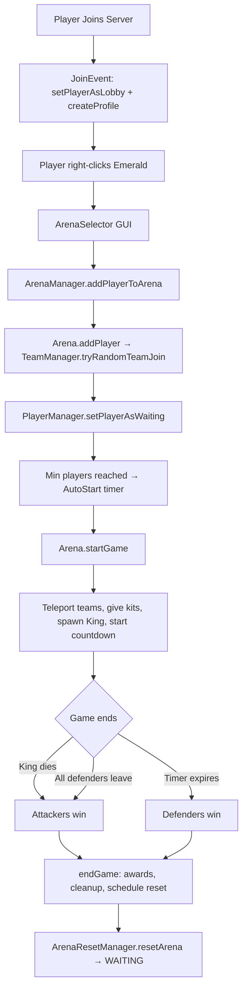

# CastleSiege — Complete Project Analysis

## Overview
CastleSiege is a Spigot 1.20.x minigame plugin (v2.1.1) where **Attackers** try to kill a King (Zombie mob) while **Defenders** protect it. Games take place in arenas that are regenerated via schematic paste after each match.

---

## Project Structure

```
me.cbhud.castlesiege
├── CastleSiege.java          (Main plugin class — bootstrapper & service locator)
├── arena/
│   ├── Arena.java             (Game instance — players, state, spawns, game flow)
│   ├── ArenaManager.java      (Arena registry, player→arena mapping, YAML persistence, WorldEdit/schematic saving)
│   ├── ArenaResetManager.java (Schematic-based arena regeneration via Regenerato)
│   ├── ArenaState.java        (Enum: WAITING, IN_GAME, ENDED)
│   └── ArenaTimerManager.java (Per-arena countdown + auto-start timers)
├── cmd/
│   └── CseCommand.java        (Single command /cse with subcommands + tab completer)
├── event/
│   ├── JoinEvent.java          (Server join/quit — lobby state, profile creation, cleanup)
│   ├── DeathEvent.java         (Player death — respawn, hardcore, kill rewards, kill effects)
│   ├── DamageEvent.java        (Friendly fire prevention, cross-arena damage blocking)
│   ├── MiscEvents.java         (Block break/place protection, item damage, food, pickup, regen)
│   ├── RightClickEffects.java  (Central dispatcher for right-click interactions)
│   ├── MenuInteractionHandler.java  (Lobby item → arena selector, waiting items → team/kit/leave)
│   ├── ThrowableAxeHandler.java     (Golden axe throw ability)
│   ├── WizardSpellHandler.java      (Blaze rod/stick wizard spells with cooldowns)
│   └── CustomItemInteractionHandler.java (Generic custom item effects + cooldowns)
├── gui/
│   ├── ArenaSelector.java      (Triumph GUI — pick arena to join)
│   ├── TeamSelector.java       (Triumph GUI — pick Attackers/Defenders)
│   ├── KitSelector.java        (Triumph GUI — select/purchase kits)
│   ├── ArenaEditorGui.java     (Admin GUI — list arenas for editing)
│   ├── ArenaSettingsGui.java   (Admin GUI — edit arena settings, spawns)
│   ├── ArenaEditChatListener.java (Chat-input for number editing in arena settings)
│   └── ArenaYmlEditor.java     (Static utility — read/write arenas.yml values)
├── kit/
│   ├── KitManager.java         (Loads kits from kits.yml, syncs to DB, KitData inner class)
│   ├── PlayerKitManager.java   (Per-player kit selection, giving kits, armor equipping)
│   ├── ItemManager.java        (Loads custom_items.yml → CustomItem objects)
│   ├── CustomItem.java         (Data model: id, ItemStack, effects, cooldown, enchantments)
│   └── KillEffectManager.java  (Loads killeffects.yml, applies on-kill rewards per kit)
├── player/
│   ├── PlayerManager.java      (State machine: IN_LOBBY→WAITING→PLAYING→SPECTATOR, lobby location)
│   └── PlayerState.java        (Enum: IN_LOBBY, WAITING, PLAYING, SPECTATOR)
├── scoreboard/
│   ├── ScoreboardManager.java  (FastBoard-based, config-driven, hex color, auto-refresh, PAPI)
│   └── NameTagManager.java     (Bukkit scoreboard teams for colored nametags)
├── team/
│   ├── Team.java               (Enum: Attackers, Defenders)
│   └── TeamManager.java        (UUID-based team tracking, balance enforcement, join/leave)
└── utils/
    ├── ConfigManager.java      (config.yml loader + accessors)
    ├── Messages.java           (messages.yml loader + PAPI placeholder support)
    ├── DataManager.java        (H2 + HikariCP database — stats, coins, kit ownership)
    ├── CustomPlaceholder.java  (PlaceholderAPI expansion — cached stats + arena info)
    ├── BossBar.java            (Adventure API boss bar for King zombie health)
    ├── MobManager.java         (King zombie spawning, damage rules, death event, fireworks)
    └── TNTThrower.java         (TNT right-click throw + explosion protection)
```

---

## Resource Files

| File | Purpose |
|------|---------|
| [plugin.yml](file:///c:/Users/cbhud/Documents/GitHub/CastleSiege/src/main/resources/plugin.yml) | Plugin descriptor. Depends on `Regenerato`, `FastAsyncWorldEdit`. Softdepends: `PlaceholderAPI`, `Multiverse-Core` |
| [config.yml](file:///c:/Users/cbhud/Documents/GitHub/CastleSiege/src/main/resources/config.yml) | Teams (max/diff), team names, nametag colors, boss bar toggle, coins-on-kill/win, king health/name, TNT/wizard cooldowns, TNT damage |
| [messages.yml](file:///c:/Users/cbhud/Documents/GitHub/CastleSiege/src/main/resources/messages.yml) | All player-facing messages, titles, GUI text, item lore. Supports `&` color codes + PAPI placeholders |
| [kits.yml](file:///c:/Users/cbhud/Documents/GitHub/CastleSiege/src/main/resources/kits.yml) | 8 kits (4 Defender, 4 Attacker). Items use `MATERIAL:AMOUNT` or `CUSTOM_ITEM:id` syntax. Has price, team, default flag, kitIcon |
| [custom_items.yml](file:///c:/Users/cbhud/Documents/GitHub/CastleSiege/src/main/resources/custom_items.yml) | Custom items with material, name, lore, cooldown, enchantments, potion effects |
| [killeffects.yml](file:///c:/Users/cbhud/Documents/GitHub/CastleSiege/src/main/resources/killeffects.yml) | Per-kit on-kill rewards: potion effects and item drops |
| [scoreboards.yml](file:///c:/Users/cbhud/Documents/GitHub/CastleSiege/src/main/resources/scoreboards.yml) | Scoreboard layouts for `lobby`, `pre-game`, `in-game`, `end` states. Supports `<#RRGGBB>` hex, `&` codes, PAPI |
| `arenas.yml` | Runtime-generated. Per-arena: spawns (world,x,y,z), min/max players, auto-start, game-timer, hardcore, schematic bounds, paste coords |
| `lobby-location.yml` | Runtime-generated. Global lobby location (world, x, y, z, yaw, pitch) |

---

## System-by-System Breakdown

### 1. Main Plugin Class — [CastleSiege.java](file:///c:/Users/cbhud/Documents/GitHub/CastleSiege/src/main/java/me/cbhud/castlesiege/CastleSiege.java)

- Acts as a **service locator** (field-based, no DI container)
- All managers are instantiated in `onEnable()` in dependency order
- `onDisable()` disconnects DB and cleans up boss bars
- Scoreboard can be disabled via `scoreboards.yml → settings.enabled`
- Registers PlaceholderAPI expansion conditionally
- Requires FAWE; disables self if missing
- Scoreboard helper methods delegate null-safely to `ScoreboardManager`

### 2. Command System — [CseCommand.java](file:///c:/Users/cbhud/Documents/GitHub/CastleSiege/src/main/java/me/cbhud/castlesiege/cmd/CseCommand.java)

Single command `/cse` registered in plugin.yml. Subcommands:

| Subcommand | Permission | Description |
|-----------|------------|-------------|
| `join <arena>` | none | Join a specific arena |
| `randomjoin` | none | Join a random WAITING arena (fallback: IN_GAME for spectating) |
| `leave` | none | Leave current arena (blocked while PLAYING) |
| `stats [player]` | none | View stats (async DB lookup) |
| `coins <add\|remove> <player> <amount>` | `cs.admin` | Admin coin management |
| `arena create <name>` | `cs.admin` | Start arena setup session (enforces 1 arena per world) |
| `arena setlobby/setking/setdefenders/setattackers` | `cs.admin` | Set spawn locations during setup |
| `arena finish` | `cs.admin` | Finalize arena (validates all spawns set, saves schematic via WorldEdit) |
| `arena cancel` | `cs.admin` | Cancel setup session |
| `arena edit` | `cs.admin` | Open GUI editor for existing arenas |
| `setlobby` | `cs.admin` | Set global lobby spawn |

> [!IMPORTANT]
> Setup sessions are stored in a `Map<UUID, Arena>` in `CseCommand`. They are NOT persisted — server restart loses incomplete setups.

### 3. Arena/Game Lifecycle — [arena/](file:///c:/Users/cbhud/Documents/GitHub/CastleSiege/src/main/java/me/cbhud/castlesiege/arena)

**States**: `WAITING → IN_GAME → ENDED → (reset) → WAITING`

**Flow**:
1. **Player joins** (`Arena.addPlayer`) → If WAITING: random team join, teleport to lobby spawn, give waiting items. If IN_GAME: spectator mode.
2. **Min players reached** → `ArenaTimerManager.startAutoStart()` begins countdown with announcements
3. **Auto-start hits 0** → `Arena.startGame()`: state → IN_GAME, world time → night, spawn King zombie, teleport teams, give kits, show boss bar, start game countdown
4. **Game countdown hits 0** → Defenders win (countdown expired). **King dies** → Attackers win (via `MobManager.onZombieDeath`). **All defenders leave/die** → Attackers win
5. **endGame()**: determines winner, plays sounds/titles, awards coins+wins (UUID-based, works for offline), schedules cleanup at 15s, schedules arena reset at 25s
6. **Arena reset**: `ArenaResetManager` pastes saved schematic via Regenerato + FAWE, then sets state back to WAITING

**Key design decisions**:
- UUIDs everywhere (no Player object leaks)
- `ArenaManager` is the single source of truth for player→arena mapping
- Each Arena creates its own `TeamManager` instance
- 1 arena per world enforced at creation time
- `ArenaTimerManager.countdownExpired` boolean decouples winner logic from task IDs

### 4. Player/Session Management — [player/](file:///c:/Users/cbhud/Documents/GitHub/CastleSiege/src/main/java/me/cbhud/castlesiege/player)

- `PlayerManager` maintains `Map<UUID, PlayerState>` (ConcurrentHashMap)
- States: `IN_LOBBY` (adventure mode, emerald arena selector), `WAITING` (survival, team/kit/leave items), `PLAYING` (survival, kit given), `SPECTATOR` (spectator mode, 1-tick delay)
- All state transitions use `runSync()` wrapper for thread safety
- Lobby location cached, loaded from `lobby-location.yml`
- `clearPlayerState()` called on quit to prevent leaks

### 5. Kit System — [kit/](file:///c:/Users/cbhud/Documents/GitHub/CastleSiege/src/main/java/me/cbhud/castlesiege/kit)

- `KitManager`: loads `kits.yml`, parses `CUSTOM_ITEM:id` references, syncs kit names/prices to DB async
- `KitData`: inner class with name, items, price, team, isDefault, kitIcon
- `PlayerKitManager`: tracks `Map<UUID, KitData>`, handles selection (validates team, checks ownership for paid kits), applies armor to slots
- Default kit auto-assigned per team on game start
- Kit purchase: transactional in DB (check coins → deduct → insert player_kits)

### 6. Ability System

Three handler classes dispatched from [RightClickEffects](file:///c:/Users/cbhud/Documents/GitHub/CastleSiege/src/main/java/me/cbhud/castlesiege/event/RightClickEffects.java):

| Handler | Trigger | Behavior |
|---------|---------|----------|
| `ThrowableAxeHandler` | Golden Axe right-click | Drops item entity with velocity, damages on proximity, removes on ground |
| `WizardSpellHandler` | Blaze Rod (attack) / Stick (support) | AoE 10-block radius, random effects to enemy/ally team, cooldown |
| `CustomItemInteractionHandler` | Any matched custom item | Applies potion effects, mushroom stew consumed, cooldown per item ID |

### 7. Scoreboard/BossBar — [scoreboard/](file:///c:/Users/cbhud/Documents/GitHub/CastleSiege/src/main/java/me/cbhud/castlesiege/scoreboard) + [BossBar](file:///c:/Users/cbhud/Documents/GitHub/CastleSiege/src/main/java/me/cbhud/castlesiege/utils/BossBar.java)

- **Scoreboard**: FastBoard library, config-driven layouts per state, hex `<#RRGGBB>` color support, PAPI integration, auto-refresh timer for configurable states
- **NameTags**: Uses Bukkit main scoreboard teams for colored name plates. Colors from config
- **BossBar**: Adventure API (`BukkitAudiences`), per-player tracking, updates King zombie health every second, cleanup on game end and plugin disable

### 8. Config/Message Loading — [ConfigManager](file:///c:/Users/cbhud/Documents/GitHub/CastleSiege/src/main/java/me/cbhud/castlesiege/utils/ConfigManager.java) + [Messages](file:///c:/Users/cbhud/Documents/GitHub/CastleSiege/src/main/java/me/cbhud/castlesiege/utils/Messages.java)

- `ConfigManager`: loads `config.yml`, provides typed getters, auto-migrates missing keys (boss-bar, nametag colors)
- `Messages`: loads `messages.yml`, all values are string lists, applies `&` color codes + PAPI placeholders per player
- `getGuiMessage(key)` for non-player contexts, `getMessage(key, player)` for player contexts

### 9. Database/Statistics/Coins — [DataManager](file:///c:/Users/cbhud/Documents/GitHub/CastleSiege/src/main/java/me/cbhud/castlesiege/utils/DataManager.java)

**Database**: H2 (file-based) via HikariCP connection pool (max 10 connections)

**Tables**:
```sql
player_stats (uuid TEXT PK, username VARCHAR(16), coins INT, kills INT, deaths INT, wins INT)
kits (id INT PK AUTO_INCREMENT, name VARCHAR(32) UNIQUE, price INT)
player_kits (player_uuid TEXT, kit_id INT, PK(player_uuid, kit_id), FK→player_stats, FK→kits)
```

**Threading pattern**:
- Write operations: `BukkitRunnable.runTaskAsynchronously()` (fire-and-forget)
- Read operations: `supplyDatabaseAsync()` → `CompletableFuture<T>` (Bukkit async scheduler)
- Profile creation: `hasData().join()` check then insert (async)
- Kit unlock: Transactional (autoCommit=false, check coins → deduct → MERGE INTO player_kits)
- Leaderboards: `getTopWins/Kills/Deaths` return `CompletableFuture<List<String>>` (top 10)

> [!WARNING]
> `getConnection()` returns `null` on failure (not an exception). Callers in `KitManager.saveOrUpdateKitInDatabase()` don't null-check — potential NPE.

### 10. PlaceholderAPI Integration — [CustomPlaceholder](file:///c:/Users/cbhud/Documents/GitHub/CastleSiege/src/main/java/me/cbhud/castlesiege/utils/CustomPlaceholder.java)

Identifier prefix: `%cs_<placeholder>%`

| Placeholder | Source |
|------------|--------|
| `cs_kills`, `cs_deaths`, `cs_wins`, `cs_coins`, `cs_kd` | Cached stats (10s refresh) |
| `cs_top_10_wins`, `cs_top_10_kills`, `cs_top_10_deaths` | Cached leaderboards (30s refresh) |
| `cs_arena`, `cs_arenasize`, `cs_arena_type` | Current arena info |
| `cs_team`, `cs_attackers_size`, `cs_defenders_size` | Team info |
| `cs_winner`, `cs_king` | Game state |
| `cs_timer`, `cs_starting-in` | Timer values |
| `cs_attackers`, `cs_defenders` | Team name strings from config |
| `cs_kit` | Selected kit name |

**Caching**: Stats cached in `ConcurrentHashMap<UUID, Integer>`, updated every 10s (main-thread snapshot → async fetch). Leaderboards updated every 30s async. Stale entries purged for offline players.

### 11. World/Map Regeneration — [ArenaResetManager](file:///c:/Users/cbhud/Documents/GitHub/CastleSiege/src/main/java/me/cbhud/castlesiege/arena/ArenaResetManager.java)

- Uses **Regenerato** library + FAWE for schematic paste
- Schematic saved during arena creation (WorldEdit selection region)
- Paste location stored in `arenas.yml` (pasteX/Y/Z)
- Double-reset prevented via `ConcurrentHashMap.newKeySet()`
- `CompletableFuture` completion triggers state reset on main thread
- If paste fails, arena stays unavailable until admin intervenes

### 12. Event Listeners

| Listener | Registration | Key behaviors |
|----------|-------------|---------------|
| [JoinEvent](file:///c:/Users/cbhud/Documents/GitHub/CastleSiege/src/main/java/me/cbhud/castlesiege/event/JoinEvent.java) | `onEnable()` | Join: lobby state + profile creation. Quit: arena removal, scoreboard cleanup, kit clear, state clear, nametag removal |
| [DeathEvent](file:///c:/Users/cbhud/Documents/GitHub/CastleSiege/src/main/java/me/cbhud/castlesiege/event/DeathEvent.java) | `onEnable()` | Clear drops, increment stats, award kill coins, apply kill effects, hardcore spectator, 5s respawn delay |
| [DamageEvent](file:///c:/Users/cbhud/Documents/GitHub/CastleSiege/src/main/java/me/cbhud/castlesiege/event/DamageEvent.java) | `onEnable()` | Block all damage to non-PLAYING. Friendly fire + cross-arena damage prevention |
| [MiscEvents](file:///c:/Users/cbhud/Documents/GitHub/CastleSiege/src/main/java/me/cbhud/castlesiege/event/MiscEvents.java) | `onEnable()` | Item durability cancelled, drops cancelled, food cancelled, fence break/place allowed for PLAYING, cobweb break for PLAYING, natural regen throttled |
| [RightClickEffects](file:///c:/Users/cbhud/Documents/GitHub/CastleSiege/src/main/java/me/cbhud/castlesiege/event/RightClickEffects.java) | `onEnable()` | Central dispatcher. Also clears cooldowns on quit |
| [MobManager](file:///c:/Users/cbhud/Documents/GitHub/CastleSiege/src/main/java/me/cbhud/castlesiege/utils/MobManager.java) | Self-registers | TNT vs King blocked. TNT damage to players configured. Defender melee/projectile vs King blocked. King death → endGame |
| [TNTThrower](file:///c:/Users/cbhud/Documents/GitHub/CastleSiege/src/main/java/me/cbhud/castlesiege/utils/TNTThrower.java) | `onEnable()` | Right-click TNT to throw with velocity. Explosion only breaks fences |
| [ArenaEditChatListener](file:///c:/Users/cbhud/Documents/GitHub/CastleSiege/src/main/java/me/cbhud/castlesiege/gui/ArenaEditChatListener.java) | `onEnable()` | Captures async chat for arena settings editing |

### 13. GUI System (Triumph GUI)

| GUI | Class | Trigger |
|-----|-------|---------|
| Arena Selector | [ArenaSelector](file:///c:/Users/cbhud/Documents/GitHub/CastleSiege/src/main/java/me/cbhud/castlesiege/gui/ArenaSelector.java) | Emerald right-click in lobby |
| Team Selector | [TeamSelector](file:///c:/Users/cbhud/Documents/GitHub/CastleSiege/src/main/java/me/cbhud/castlesiege/gui/TeamSelector.java) | Clock right-click in waiting |
| Kit Selector | [KitSelector](file:///c:/Users/cbhud/Documents/GitHub/CastleSiege/src/main/java/me/cbhud/castlesiege/gui/KitSelector.java) | Nether Star right-click in waiting |
| Arena Editor | [ArenaEditorGui](file:///c:/Users/cbhud/Documents/GitHub/CastleSiege/src/main/java/me/cbhud/castlesiege/gui/ArenaEditorGui.java) | `/cse arena edit` |
| Arena Settings | [ArenaSettingsGui](file:///c:/Users/cbhud/Documents/GitHub/CastleSiege/src/main/java/me/cbhud/castlesiege/gui/ArenaSettingsGui.java) | Click arena in editor |

> [!NOTE]
> `ArenaSelector` rebuilds items on every `open()` call (fresh data). `KitSelector` and `TeamSelector` build items once in constructor (stale if kits/config change at runtime).

---

## Dependencies (pom.xml)

| Dependency | Scope | Shaded? | Purpose |
|-----------|-------|---------|---------|
| Spigot API 1.20.1 | provided | No | Server API |
| FastBoard 2.1.5 | compile | No | Scoreboard library |
| Regenerato 1.4-SNAPSHOT | provided | No | Schematic paste for arena reset |
| WorldEdit Core/Bukkit 7.2.14 | provided | No | Selection API for arena saving |
| H2 Database 2.3.232 | compile | No | Embedded database |
| Triumph GUI 3.1.13 | compile | Yes (relocated) | GUI framework |
| HikariCP 6.3.0 | compile | No | Connection pooling |
| PlaceholderAPI 2.11.6 | provided | No | Placeholder expansion |

> [!NOTE]
> Java source: 16. pom.xml says `java.version: 1.8` in properties but compiler source/target is 16. Plugin uses Java 16 features (pattern matching `instanceof`, switch expressions, text blocks).

---

## Conventions & Code Style

1. **Service locator pattern** — all managers accessed via `plugin.getXxxManager()`
2. **UUID-keyed maps** — no `Player` object storage (prevents memory leaks)
3. **`runSync()` wrapper** — ensures Bukkit API calls happen on main thread
4. **Async DB operations** — writes via `BukkitRunnable.runTaskAsynchronously()`, reads via `CompletableFuture`
5. **Messages as string lists** — all messages in `messages.yml` are lists (even single lines), accessed via `getMessage(key, player)`
6. **GUI via Triumph** — `ItemBuilder.from(mat).name(Component.text(...)).lore(...).asGuiItem(event -> ...)`
7. **Color codes** — `&` codes translated via `ChatColor.translateAlternateColorCodes('&', ...)`, hex via `<#RRGGBB>` in scoreboards
8. **Config migration** — `ConfigManager.setup()` adds missing keys and saves
9. **Arena editing** — GUI + chat input flow, saves to `arenas.yml`, hot-reloads if arena is inactive
10. **Permission**: `cs.admin` for admin commands

---

## Key Relationships & Data Flow



---

## Potential Gotchas for Future Development

> [!WARNING]
> **These are observations, not bugs to fix. Only relevant when making changes.**

1. **KitSelector/TeamSelector** are built once in constructor — won't reflect runtime config changes without restart
2. **`MenuInteractionHandler.handleLeaveItem`** calls `arena.removePlayer()` directly instead of going through `ArenaManager.removePlayerFromArena()` — the player→arena mapping cleanup still happens because `Arena.removePlayer()` calls `arenaManager.unmapPlayer()`
3. **`DataManager.getConnection()`** returns `null` on failure — some callers (e.g., `KitManager.saveOrUpdateKitInDatabase`) will NPE
4. **MobManager** holds a single `kingZombie` field — with multiple arenas on different worlds, the field gets overwritten on each spawn. The `getKingZombie(world)` fallback scan mitigates this but is O(n) on entities
5. **ArenaTimerManager** uses `scheduleSyncRepeatingTask` and stores raw int task IDs — cleanup relies on `stopCountdown()`/`stopAutoStart()` being called
6. **No reload command** — no `/cse reload`. Config changes require restart (except arena settings via GUI)
7. **`AsyncPlayerChatEvent`** used in `ArenaEditChatListener` — this event fires async, but all Bukkit calls are properly dispatched to main thread via `runTask()`
